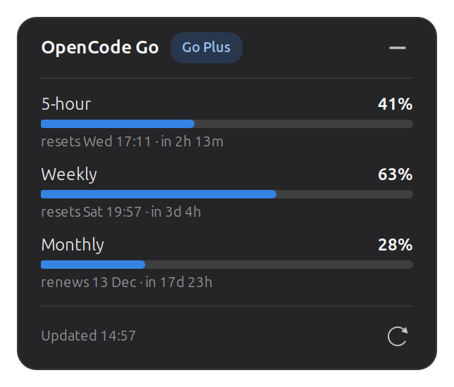
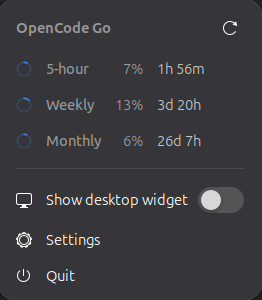

# OpenCode Go usage widget

A usage gauge for [OpenCode Go](https://opencode.ai/docs/go/) on the Ubuntu
desktop. It has two halves that work together: a **GNOME Shell extension** for
the top bar, and a **GTK app** that owns the API key, polling, the desktop card
and notifications.





## Features

- **Panel ring gauge** filled with your highest limit. It stays monochrome below
  70%, turns amber at 70%, red at 90%, and shows the weekly limit as
  `N% used` next to it.
- **Dropdown** with one row per limit in real columns, a refresh button that
  spins while a request is in flight, and a **Show desktop widget** switch.
- **Desktop card** with bars, reset countdowns, and a spinning refresh control.
  Minimize/expand without the title bar moving, drag it anywhere, and it floats
  above other windows without ever taking keyboard focus.
- **Autostart switch** in Settings, plus notifications at 90% and a tray-icon
  fallback when the extension is not available.

The API key never leaves the machine: requests go straight to
`https://opencode.ai/inference/go/v1/usage`.

## Requirements

- GNOME Shell **50 or 51** (the extension's `shell-version` field).
- `python3-gi`, `python3-cairo`, `gir1.2-gtk-3.0`,
  `gir1.2-ayatanaappindicator3-0.1`. Notifications additionally use
  `gir1.2-notify-0.7`; everything works without it.

On Ubuntu/Debian:

```sh
sudo apt install python3-gi python3-cairo gir1.2-gtk-3.0 \
    gir1.2-ayatanaappindicator3-0.1 gir1.2-notify-0.7
```

## Install

```sh
git clone https://github.com/xiaohai-huang/opencode-go-widget.git
cd opencode-go-widget
./install.sh
```

Then **log out and back in** (a newly installed extension is only loaded by a
fresh shell session), click the ring → **Settings**, and paste your own
OpenCode Go key.

See [INSTALL.md](INSTALL.md) for details, dependencies and uninstall.

## Layout

| Path | Purpose |
| --- | --- |
| `app/` | GTK app: card, polling, D-Bus service, settings. Run with `app/bin/opencode-go-widget` |
| `extension/` | GNOME Shell extension: panel ring + weekly label + dropdown |
| `docs/` | screenshots |
| `install.sh`, `uninstall.sh` | per-user install into `~/.local/share` |

## How it works

- The Python process is the single owner of the API key, polling, response
  parsing and the Cairo-rendered ring icons. The extension is pure UI and talks
  to it over the session bus (`org.opencode_go.Widget`: `GetUsage`, `Refresh`,
  `OpenSettings`, `SetCardVisible`, signal `UsageChanged`). Payloads are also
  mirrored to `~/.cache/opencode-go-widget/status.json` so the extension can
  render the last known numbers if the app is not running.
- The extension claims `org.opencode_go.ShellUI` while it is active; the app
  watches for that name and retires its own appindicator so there is only ever
  one panel item.
- The popup uses `St` actors with widths measured by the renderer itself
  (`get_preferred_width`), which is why its columns line up: an appindicator
  DBusMenu can only carry text, and space-padding there drifts between rows.
- Editing extension JS **requires a re-login**: GNOME 51 declares
  `org.gnome.Shell.Extensions.ReloadExtension` but does not implement it, and
  disable/enable reuses the cached ES module.

Deeper implementation notes are in [app/README.md](app/README.md).

## Development

Run straight from a checkout without installing:

```sh
app/bin/opencode-go-widget --demo          # sample numbers
app/bin/opencode-go-widget --once          # print usage, exit
app/bin/opencode-go-widget --screenshot out.png
```

## License

No license has been chosen yet. Add one before publishing publicly.
